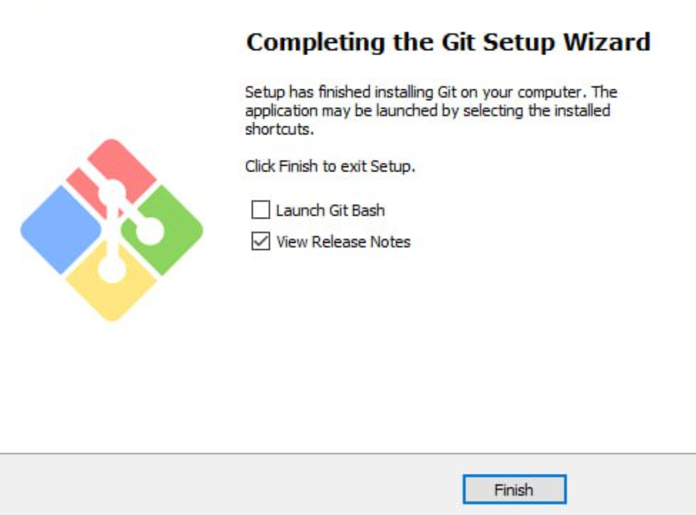
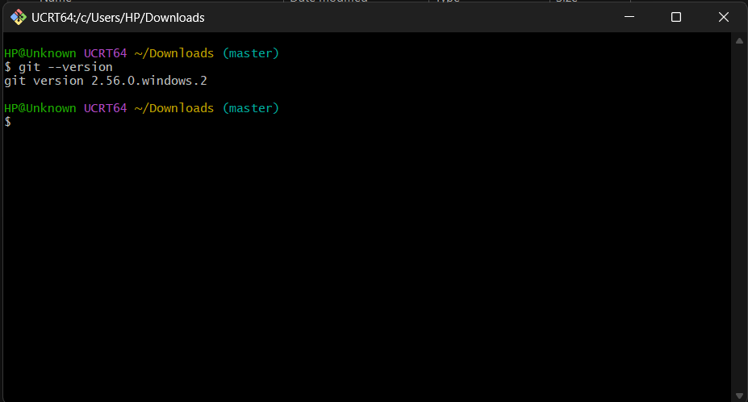
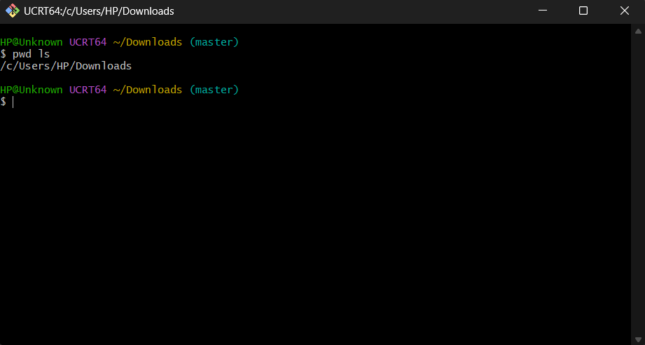
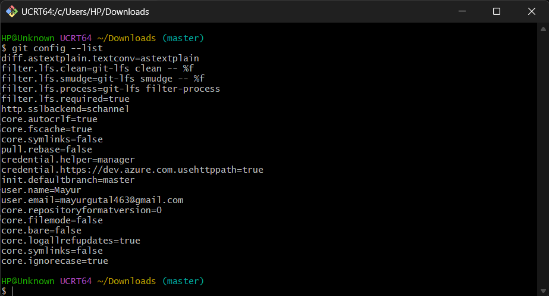

### Step 1: Installing Git on Your System

To set up version control on Windows, we download and install the official Git package.

1. **Download the installer:** Open your browser, search for "Git for Windows", and download the installer from the official website.
2. **Run setup:** Double-click the downloaded setup file in your Downloads folder to launch the installation wizard.
3. **Choose setup options:** Accept the license terms, select the default installation folder, and check the option to add an icon on the Desktop for quick access.
4. **Complete installation:** Keep the default settings through the wizard steps, click **Install**, and finish the setup.
  
**Screenshot Evidence:** This screenshot displays the Git setup wizard finishing successfully on the Windows operating system.

---

### Step 2: Verifying Git Installation

After completing setup, we verify that Git is installed correctly and recognized by the operating system.

**Command used:**
```bash
git --version
```

**Expected output:**
```text
git version 2.56.0.windows.2
```

**Explanation:** Running `git --version` asks the system to identify the active version of Git. Seeing the version number printed in the console confirms that Git is installed properly and ready to run commands.

  
**Screenshot Evidence:** This image shows the terminal running `git --version` and printing the installed version number, confirming successful installation.

---

### Step 3: Demonstrating Git Bash Usage

Git installs a dedicated command-line environment called **Git Bash**, which provides a Unix-like shell on Windows.

1. **Opening Git Bash:** Double-click the Git Bash shortcut on the Desktop or search for "Git Bash" in the Windows Start menu.
2. **The command prompt:** Git Bash displays a terminal prompt ending with a `$` symbol where you type commands.
3. **Running basic navigation commands:**

**Commands used:**
```bash
pwd
ls
clear
```

**Explanation of actions:**
* `pwd`: Prints the current working directory path so you know which folder you are in.
* `ls`: Lists all files and folders inside the current directory.
* `clear`: Clears the terminal screen to keep your workspace neat.
* *(Alternative environment)*: You can also open the integrated terminal in Visual Studio Code to execute these exact same commands.

  
**Screenshot Evidence:** This screenshot captures the Git Bash window actively executing `pwd` and `ls`, demonstrating proper terminal navigation.

---

### Step 4: Configuring Global Username and Email

Every commit in Git needs to identify who wrote the code. Setting your username and email globally links your work across all projects on your computer to your identity.

**Commands used:**
```bash
git config --global user.name "Your Name"
git config --global user.email "your.email@example.com"
```

**Verifying the configuration:**
```bash
git config --list
```

**Expected output (bottom lines):**
```text
user.name=Your Name
user.email=your.email@example.com
```

**Explanation:** 
* The `--global` flag ensures that these credentials apply to every repository created or updated on your machine.
* Running `git config --list` prints your full configuration list, allowing you to confirm that both `user.name` and `user.email` are recorded correctly. If the output pauses in the viewer, press `q` to return to the prompt.

  
**Screenshot Evidence:** This screenshot shows the terminal output of `git config --list` displaying the configured global username and email address.

---

### Step 5: Verification Summary & Screenshot Checklist

This table confirms that all assignment requirements and evaluation criteria are fulfilled:

| Evaluation Criterion | Requirement Checked | Command Used | Evidence File |
| :--- | :--- | :--- | :--- |
| **1. Git Installed** | Git installed on Windows via setup wizard | Setup installer (`.exe`) | `screenshots/01_git_installation.png` |
| **2. Version Verified** | Version command executed and verified | `git --version` | `screenshots/02_git_version.png` |
| **3. Identity Configured** | Global user identity set and confirmed | `git config --global ...` & `git config --list` | `screenshots/04_git_config_verification.png` |
| **4. Terminal Demonstrated** | Git Bash opened and shell commands executed | `pwd`, `ls`, `clear` | `screenshots/03_git_bash_usage.png` |
| **5. Evidence Provided** | Visual proof and explanations for all steps | Markdown screenshot links with captions | All screenshots documented above |

---
