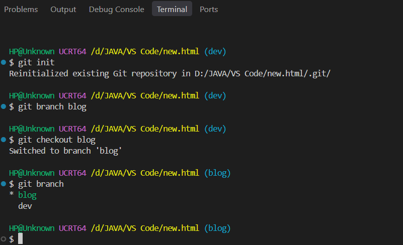
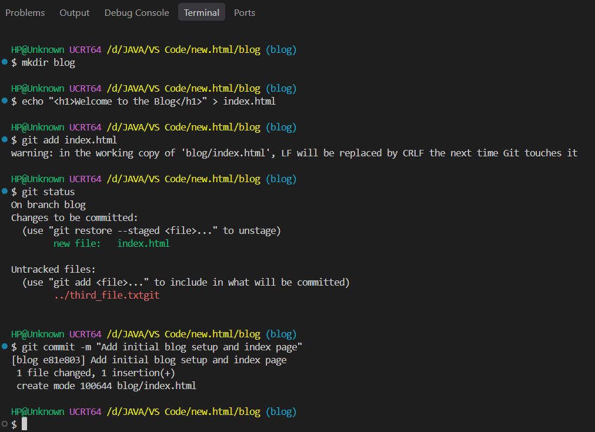
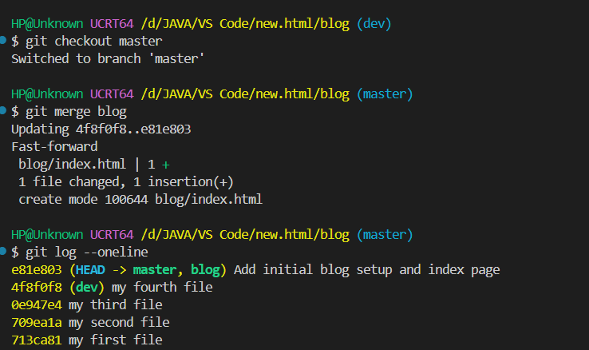
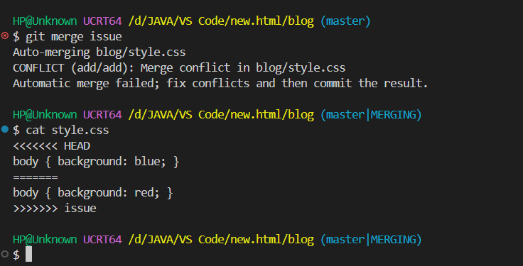
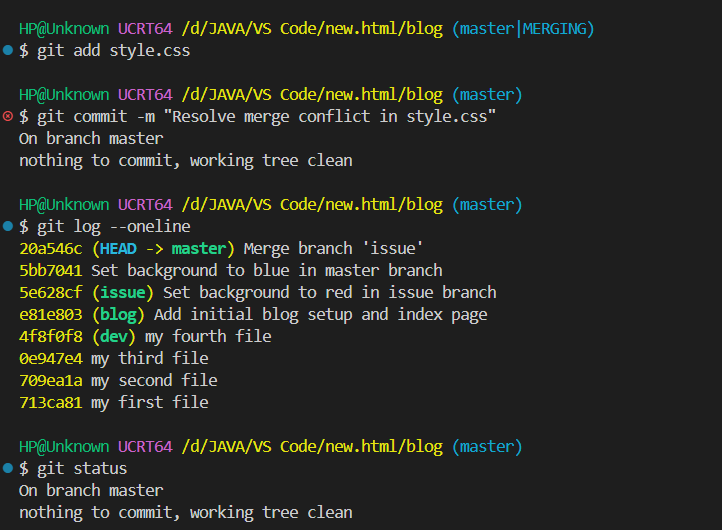

### Step 1: Creating and Switching Between Branches

In Git, a **branch** is an independent timeline where you can safely build new features or experiment without modifying your working `master` or `main` branch.

#### 1. Listing existing branches
To check the current branch in the repository:

```bash
git branch
```

**Terminal output:**
```text
* master
```

#### 2. Creating and switching into a new branch
To create a dedicated branch for a blog feature and switch into it:

```bash
git branch feature-blog
git checkout feature-blog
```

**Terminal output:**
```text
Switched to branch 'feature-blog'
```

Running `git branch` again confirms that `feature-blog` is now the active branch marked with an asterisk (`*`).

  
**Screenshot Evidence:** This screenshot displays the terminal running `git branch`, creating `feature-blog`, and using `git checkout` to switch into the new branch.

---

### Step 2: Making Changes in a Separate Branch

Once inside the new branch, any files created, edited, or committed remain completely isolated from the primary branch.

#### 1. Creating and committing files on the feature branch
```bash
mkdir blog
echo "<h1>Welcome to the Blog</h1>" > blog/index.html
git add blog/index.html
git commit -m "Add initial blog setup and index page"
```

**Terminal output:**
```text
[feature-blog 5b7a1c9] Add initial blog setup and index page
 1 file changed, 1 insertion(+)
 create mode 100644 blog/index.html
```

**Explanation:**  
This commit snapshot exists solely within `feature-blog`. If you switch back to `master`, the `blog` directory will not appear there until the branch is merged.

  
**Screenshot Evidence:** This image shows the creation of `blog/index.html`, staging with `git add`, and recording the commit inside the `feature-blog` branch.

---

### Step 3: Merging the Branch into Master

After testing your work in isolation, you bring those updates into your main line of development through a **merge**.

#### 1. Switching to the receiving branch
Before running a merge, always move to the branch that should receive the updates:

```bash
git checkout master
```

#### 2. Merging the feature branch
```bash
git merge feature-blog
```

**Terminal output:**
```text
Updating 4a1e9b2..5b7a1c9
Fast-forward
 blog/index.html | 1 +
 1 file changed, 1 insertion(+)
 create mode 100644 blog/index.html
```

#### 3. Verifying the merged history
```bash
git log --oneline
```

**Terminal output:**
```text
5b7a1c9 (HEAD -> master, feature-blog) Add initial blog setup and index page
4a1e9b2 Initial project setup commit
```

**Explanation:**  
Because no other commits were added to `master` in the meantime, Git performs a clean **fast-forward** merge, advancing the `master` pointer to include the commits from `feature-blog`.

  
**Screenshot Evidence:** This screenshot captures `git checkout master` followed by `git merge feature-blog` completing a fast-forward merge.

---

### Step 4: Demonstrating and Resolving a Merge Conflict

A **merge conflict** occurs when two branches modify the exact same line of code in different ways. Git pauses the merge process to avoid accidentally deleting anyone's work.

```text
       ┌── [Branch A: body { background: red; }]  ──┐
───────┤                                             ├─► Merge Conflict!
       └── [Branch B: body { background: blue; }] ──┘
```

#### 1. Triggering the conflict
When merging a branch that clashes with changes already committed to `master`:

```bash
git merge issue-branch
```

**Terminal output:**
```text
Auto-merging style.css
CONFLICT (content): Merge conflict in style.css
Automatic merge failed; fix conflicts then commit the result.
```
*(The terminal prompt changes to `master|MERGING`, indicating that manual conflict resolution is required).*

#### 2. Inspecting the conflict markers in the file
Opening `style.css` reveals the conflict markers added by Git:

```css
body { background: blue; }
body { background: red; }
```

* `<<<<<<< HEAD`: Marks the version currently on your active branch (`master`).
* `=======`: The divider line separating the two conflicting versions.
* `>>>>>>> issue-branch`: Marks the end of the version coming from the branch being merged.

  
**Screenshot Evidence:** This screenshot displays the terminal reporting `CONFLICT (content)` alongside the code editor showing the `<<<<<<< HEAD`, `=======`, and `>>>>>>>` markers.

#### 3. Resolving the conflict
To resolve the conflict:
1. Open `style.css` and decide which line of code to keep (e.g., `body { background: blue; }`).
2. Delete all marker lines (`<<<<<<<`, `=======`, and `>>>>>>>`).
3. Save the file, stage it, and record the resolution commit:

```bash
git add style.css
git commit -m "Resolve merge conflict in style.css"
```

**Terminal output:**
```text
[master 8d3e1a0] Resolve merge conflict in style.css
```

  
**Screenshot Evidence:** This image shows the resolved `style.css` file staged with `git add` and committed, returning the branch status to a clean state.

---
