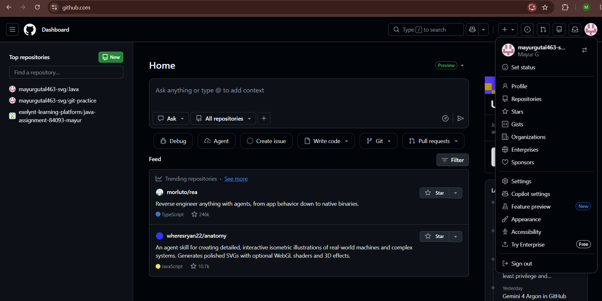
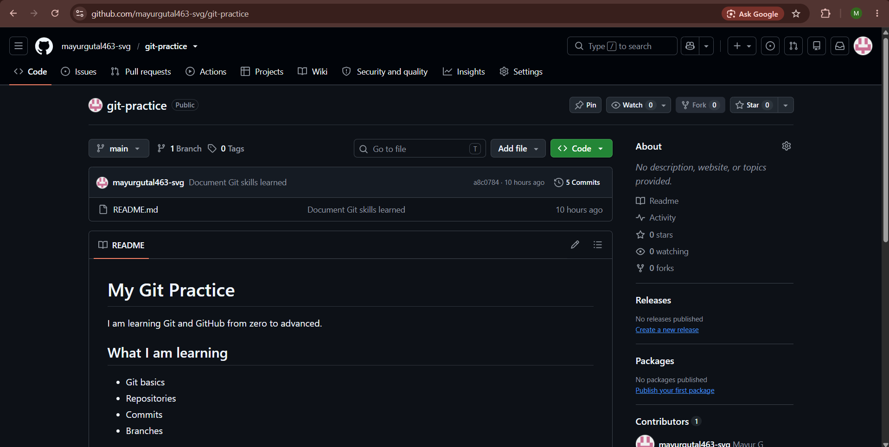
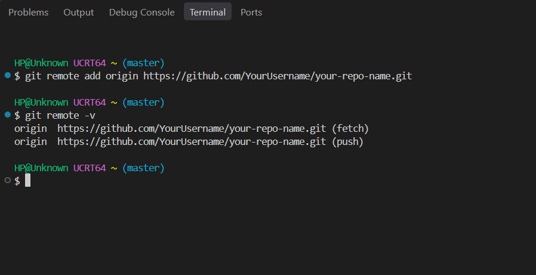
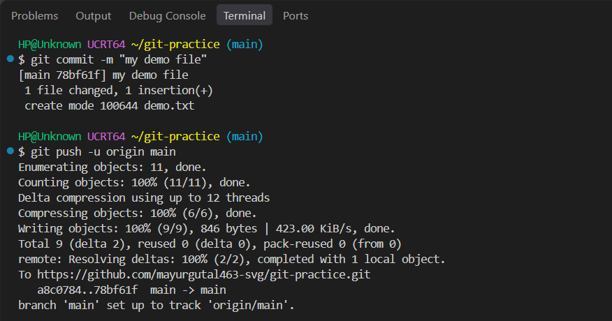
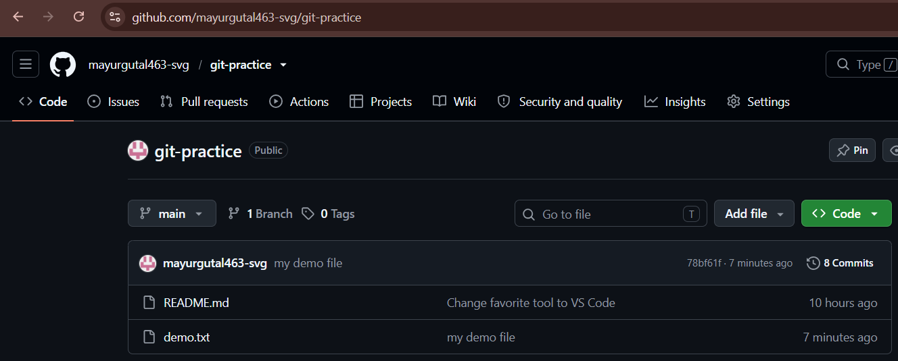

### Step 1: Creating a GitHub Account

To host and share projects online, we first create an account on **GitHub**.

1. **Visit GitHub:** Go to the official website at `github.com` in your web browser.
2. **Sign up:** Click the sign-up button and register with your email address, a password, and a chosen username.
3. **Select plan:** Choose the free plan, which provides all the necessary features for creating repositories and collaborating on code.
4. **Log in:** Complete email verification and log in to reach your personal GitHub dashboard.

  
**Screenshot Evidence:** This screenshot displays the logged-in GitHub homepage and user profile menu, confirming successful account setup.

---

### Step 2: Creating a New Remote Repository on GitHub

A **remote repository** is a version of your project stored in the cloud rather than solely on your local computer hard drive.

#### 1. Why remote repositories are important
* **Safe cloud backup:** Because the files live online on GitHub servers, your project remains safe even if your local computer crashes, breaks, or gets damaged.
* **Team collaboration:** Multiple developers can work simultaneously on the same codebase, commit their changes, and merge their branches without the confusion of emailing files back and forth.

#### 2. Creating the repository on GitHub
1. Click the **+** (plus) icon in the top navigation bar or click the green **New** button under the Repositories section.
2. Enter a repository name matching your local project (for example, `my-git-project` or `web-portfolio`).
3. An optional description can be added to explain the project.
4. Select **Public** so others can see your work.
5. Leave the options to initialize with a README, `.gitignore`, and license unchecked, because we are pushing an existing local repository.
6. Click the green **Create repository** button.

GitHub now opens a "Quick setup" page displaying your new repository link (e.g. `https://github.com/YourUsername/my-git-project.git`) along with command-line instructions.

  
**Screenshot Evidence:** This screenshot displays the newly created, empty repository page on GitHub showing the repository URL and quick setup terminal instructions.

---

### Step 3: Connecting the Local Repository to GitHub (`git remote add`)

To send your work to GitHub, you need to link your local repository folder to the remote repository URL.

#### 1. Linking the remote URL
Open your terminal or Git Bash inside your project folder and run:

```bash
git remote add origin https://github.com/YourUsername/my-git-project.git
```

#### 2. Understanding what this command does
* `git remote add`: Tells Git to set up a connection to an external remote repository.
* `origin`: The standard alias (short name) used to represent your remote URL. Instead of typing out the long website link every time you save or share code, Git uses `origin` like a variable that points directly to that address.
* `<URL>`: The exact web link copied from your newly created repository page on GitHub.

#### 3. Verifying the remote connection
To confirm that Git stored the address correctly, list your configured remotes:

```bash
git remote -v
```

**Expected terminal output:**
```text
origin  https://github.com/YourUsername/my-git-project.git (fetch)
origin  https://github.com/YourUsername/my-git-project.git (push)
```

**Explanation:**  
The terminal confirms that `origin` is now linked to your GitHub repository for both fetching and pushing data.

  
**Screenshot Evidence:** This screenshot displays the terminal running `git remote add origin` with the repository URL, followed by `git remote -v` confirming the active connection.

---

### Step 4: Pushing Local Commits to GitHub (`git push`)

Once the connection is established, we **push** our saved snapshots from our computer up to GitHub.

#### 1. Checking the local repository state
Before pushing, ensure that your working directory is clean and check which branch you are on:

```bash
git status
git branch
```

**Expected terminal output:**
```text
On branch master
nothing to commit, working tree clean
```
*(Note: If your local branch is named `main` or `master`, confirm the name displayed by Git before continuing).*

#### 2. Pushing changes to the remote repository
To upload your branch and its commit history to GitHub, run:

```bash
git push -u origin master
```
*(If your branch is named `main`, run `git push -u origin main` instead).*

**Expected terminal output:**
```text
Enumerating objects: 6, done.
Counting objects: 100% (6/6), done.
Delta compression using up to 8 threads
Compressing objects: 100% (4/4), done.
Writing objects: 100% (6/6), 550 bytes | 550.00 KiB/s, done.
Total 6 (delta 1), reused 0 (delta 0), pack-reused 0
To https://github.com/YourUsername/my-git-project.git
 * [new branch]      master -> master
branch 'master' set up to track 'origin/master'.
```

**Explanation of terms:**  
* `git push`: The command that transfers files and commit snapshots from your local machine over to the remote repository.
* `origin`: Refers to your saved GitHub repository URL.
* `master` (or `main`): Specifies the branch you are sending up to GitHub.
* `-u`: Sets the upstream link, meaning Git remembers this pairing so you can type just `git push` in future updates.

  
**Screenshot Evidence:** This screenshot shows the terminal executing the `git push` command, writing objects, and confirming that the local branch is successfully published to `origin`.

---

### Step 5: Verifying the Project on GitHub

After the push completes, return to your web browser and refresh your GitHub repository page:

* **Files are online:** All local project files and folders (e.g. `index.html`, `style.css`, etc.) appear listed on the repository homepage.
* **Commit history preserved:** Clicking on the **commits** tab reveals all past snapshots, author names, dates, and commit messages recorded on your computer.

  
**Screenshot Evidence:** This screenshot displays the refreshed repository page on GitHub showing the uploaded project files, the latest commit message, and the total commit count.

---