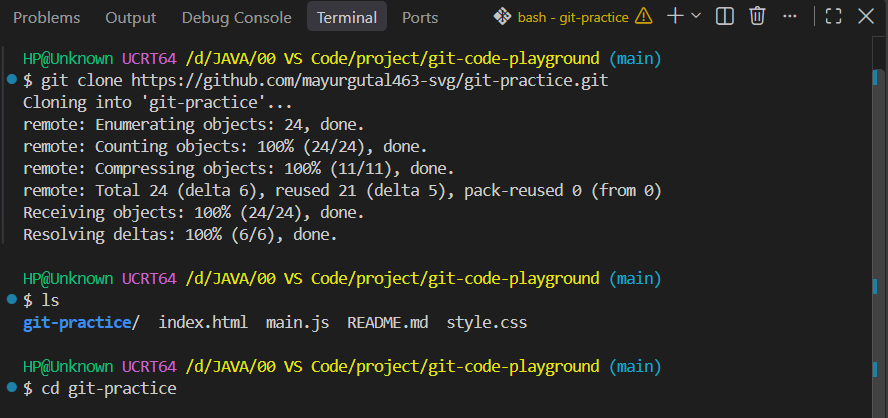
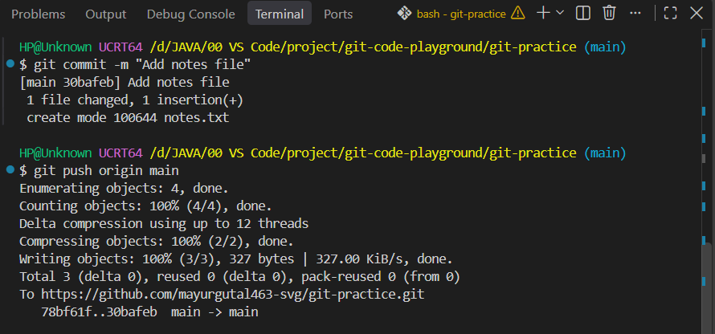
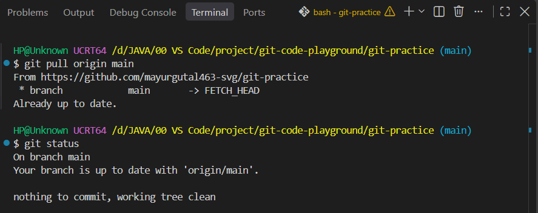

### Step 1: Cloning a Remote Repository (`git clone`)

Cloning allows you to download an entire existing remote repository from GitHub directly onto your local machine.

#### 1. Cloning the repository
To create a local copy of a remote project, run `git clone` followed by the repository URL:

```bash
git clone https://github.com/YourUsername/devops-project.git
cd devops-project
```

**Expected terminal output:**
```text
Cloning into 'devops-project'...
remote: Enumerating objects: 12, done.
remote: Counting objects: 100% (12/12), done.
remote: Compressing objects: 100% (8/8), done.
remote: Total 12 (delta 2), reused 10 (delta 1), pack-reused 0
Receiving objects: 100% (12/12), done.
Resolving deltas: 100% (2/2), done.
```

**Explanation:**  
Running `git clone` downloads all files, branches, and the full commit history into a new folder on your computer. Git automatically configures the default branch (such as `main` or `master`) and links your local folder back to the remote repository URL.

  
**Screenshot Evidence:** This screenshot displays the terminal running `git clone` with the repository URL and entering the newly downloaded project directory.

---

### Step 2: Understanding `origin` and `main`

When working with remote repositories in Git, `origin` and `main` are two foundational terms:

```text
  [ Local Machine ] ──────── git push / git pull ────────► [ Remote GitHub Repository ]
   Branch: main                                               Alias: origin
```

#### 1. What is `origin`?
* `origin` is the default shorthand alias (nickname) that Git assigns to your remote repository URL.
* Instead of typing a long web address (like `https://github.com/YourUsername/devops-project.git`) every time you synchronize your code, Git lets you use `origin` as a convenient reference pointer.
* You can verify the URL assigned to `origin` at any time by running `git remote -v`.

#### 2. What is `main` (or `master`)?
* `main` (historically called `master` in older setups) represents the primary, default branch of your project.
* It contains the stable, production-ready version of your codebase.
* In professional projects, developers avoid modifying `main` directly; instead, they create separate feature branches and merge them into `main` after review.

**Everyday analogy:**  
Think of `origin` as the contact card in your phone labeled "Office". You dial "Office" instead of memorizing the full 10-digit telephone number every time. In this setup, `main` is like the master copy of an office handbook; individual team members write draft pages in separate notebooks before updating the master book.

---

### Step 3: Making Local Changes and Pushing to GitHub (`git push`)

Once you make changes locally, you stage, commit, and **push** them to GitHub so they appear online.

#### 1. Creating a file and saving a commit
```bash
echo "Server configuration data" > config.txt
git add config.txt
git commit -m "Add server configuration file"
```

#### 2. Pushing changes to the remote repository
To send your committed updates to GitHub, run `git push` specifying the remote alias and the target branch:

```bash
git push origin main
```
*(If your primary branch is named `master`, use `git push origin master`).*

**Expected terminal output:**
```text
Enumerating objects: 4, done.
Counting objects: 100% (4/4), done.
Writing objects: 100% (3/3), 320 bytes | 320.00 KiB/s, done.
Total 3 (delta 0), reused 0 (delta 0), pack-reused 0
To https://github.com/YourUsername/devops-project.git
   4a1e9b2..8c2d1e0  main -> main
```

**Explanation:**  
Running `git push` uploads your local commits to the remote repository on GitHub. If you are pushing a new branch for the first time, Git creates that branch on the remote server automatically.

  
**Screenshot Evidence:** This screenshot captures the terminal executing `git push origin main`, writing objects to GitHub, and updating the remote branch reference.

---

### Step 4: Pulling Remote Updates to Keep Repositories in Sync (`git pull`)

When working on a shared repository, teammates may add new commits to GitHub. Before you can push new work, your local environment must be synchronized with the remote repository.

#### 1. Why `git push` gets rejected if out of sync
If someone creates or edits a file directly on GitHub, the remote branch contains updates that your local laptop does not have. If you attempt to push in this state, Git rejects the upload with an error to protect against overwriting data:

```text
To https://github.com/YourUsername/devops-project.git
 ! [rejected]        main -> main (fetch first)
error: failed to push some refs to 'https://github.com/YourUsername/devops-project.git'
```

#### 2. Synchronizing with `git pull`
To bring your local repository up to date, use `git pull`:

```bash
git pull origin main
```

**Expected terminal output:**
```text
remote: Enumerating objects: 3, done.
remote: Counting objects: 100% (3/3), done.
remote: Compressing objects: 100% (2/2), done.
Unpacking objects: 100% (3/3), done.
From https://github.com/YourUsername/devops-project
 * branch            main     -> FETCH_HEAD
Updating 8c2d1e0..f1e4b9a
Fast-forward
 devops.txt | 1 +
 1 file changed, 1 insertion(+)
 create mode 100644 devops.txt
```

**Explanation:**  
The `git pull` command retrieves all new files, directories, and commit history from the remote repository and immediately integrates them into your current local branch. Once synchronized, you can push your changes without rejection.

  
**Screenshot Evidence:** This screenshot shows the terminal executing `git pull origin main` to download new remote files, followed by `git status` verifying that the local branch is up to date with `origin/main`.

---

### Step 5: Real-Life Collaboration Workflow

In professional software development and DevOps teams, multiple engineers work on the same project simultaneously without clashing.

```text
[ Remote Repository (GitHub) ]
         │
         ├───► git clone (Developer downloads project)
         │
         ├───► git checkout -b feature/TASK-101 (Creates isolated branch)
         │
         ├───► git add & git commit (Builds feature locally)
         │
         ├───► git pull origin main (Syncs latest changes)
         │
         ├───► git push origin feature/TASK-101 (Uploads branch)
         │
         └───► Pull Request (PR) ──► Code Review ──► Merged into main
```

#### 1. Cloning the project
Every engineer starts by cloning the central repository to their local workstation: `git clone <URL>`.

#### 2. Creating an isolated task branch
Engineers never commit untested code directly to `main`. Instead, they create a separate branch typically named after a project tracking ticket (such as Jira or Rally): `git checkout -b task-5265`. This makes it straightforward to audit which ticket introduced a specific change.

#### 3. Working, staging, and committing
The developer writes code, verifies functionality, stages files using `git add .`, and records descriptive milestone snapshots with `git commit -m "..."`.

#### 4. Pulling before pushing
Before pushing code, the developer pulls the latest commits from the main remote branch (`git pull origin main`) to ensure their local branch has all recent updates from colleagues and avoids push rejection.

#### 5. Pushing the branch and opening a Pull Request (PR)
The engineer pushes their branch to GitHub: `git push origin task-5265`. On GitHub, they create a **Pull Request (PR)**, which invites teammates to review the code, run automated tests, and discuss adjustments before merging the updates into `main`.

---