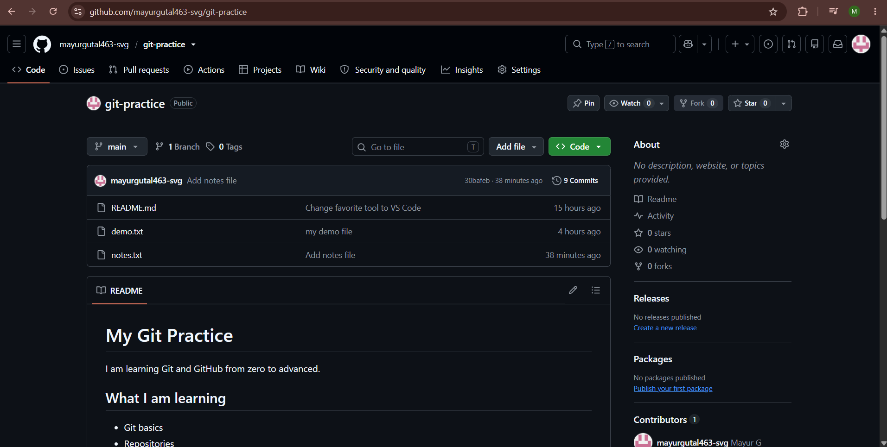
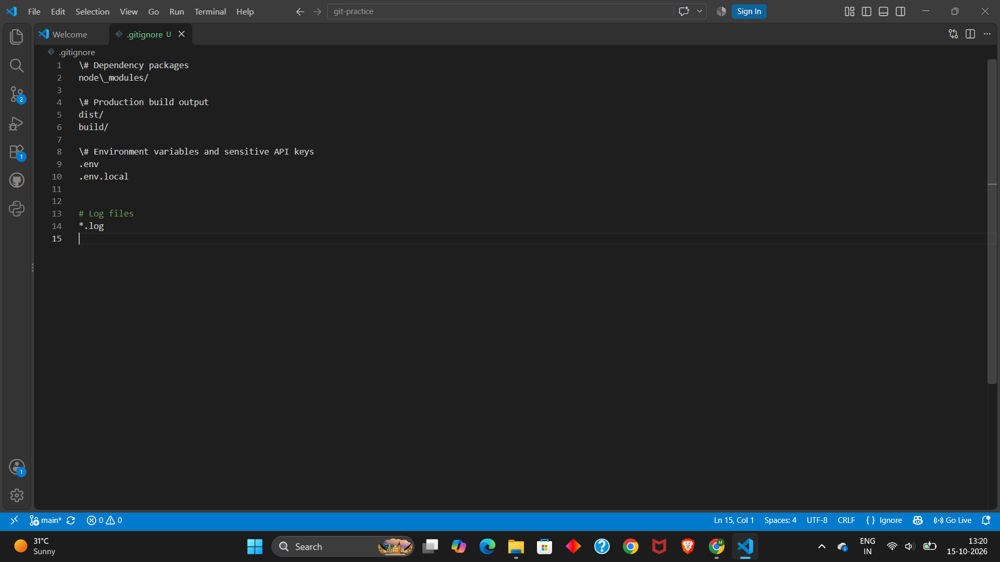
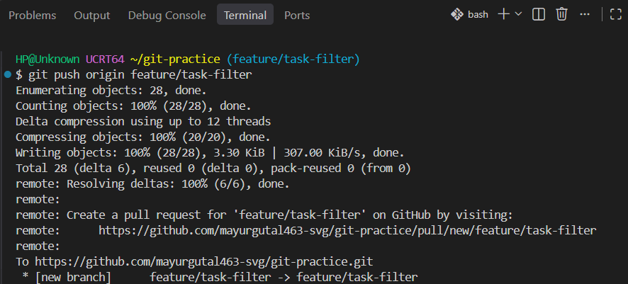
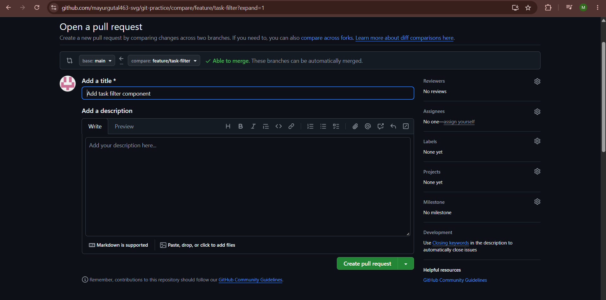

### Step 1: Project Organization and Creating a Comprehensive `README.md`

In any collaborative repository, the `README.md` acts as the front door and official documentation for the project, welcoming visitors and explaining how the application functions.

#### 1. Recommended React repository structure
To keep the project clean and organized, files are arranged in standard frontend directories:

```text
my-react-app/
├── .gitignore
├── README.md
├── package.json
├── package-lock.json
├── public/
│   └── index.html
└── src/
    ├── App.css
    ├── App.jsx
    └── main.jsx
```

#### 2. Writing a professional `README.md`
Create a `README.md` file in the root folder of the repository:

```markdown
# React Task Tracker

A modern web application built with React to help users organise daily tasks and track project milestones.

## Features
- Create, edit, and delete daily tasks.
- Interactive status filters (Pending, In Progress, Completed).
- Responsive layout designed for desktop and mobile devices.

## Tech Stack
- **Frontend:** React, CSS3, JavaScript (ES6)
- **Tooling:** Vite, Git, GitHub
- **Package Manager:** npm

## Getting Started

### Prerequisites
- Node.js (v18 or higher)
- npm

### Installation
1. Clone the repository:
   ```bash
   git clone https://github.com/YourUsername/react-task-tracker.git
   cd react-task-tracker
   ```
2. Install project dependencies:
   ```bash
   npm install
   ```
3. Start the local development server:
   ```bash
   npm run dev
   ```

## Contributing
1. Fork the project or create your feature branch (`git checkout -b feature/new-feature`).
2. Commit your changes (`git commit -m "Add new feature"`).
3. Push to the branch (`git push origin feature/new-feature`).
4. Open a Pull Request for review.
```

**Explanation:**  
A well-structured `README.md` provides clear instructions so any developer cloning the repository can install packages, run the code locally, and understand the project without guessing.

  
**Screenshot Evidence:** This screenshot displays the formatted `README.md` rendered on the GitHub repository homepage with project descriptions, setup instructions, and badges.

---

### Step 2: Configuring `.gitignore` for a React Project

A `.gitignore` file specifies intentionally untracked files that Git should ignore and never push into the cloud.

#### 1. Creating the `.gitignore` file
Inside the project root directory, create a file named `.gitignore`:

```text
# Dependency directory (never commit node_modules)
node_modules/

# Production build output
dist/
build/

# Local environment variables and secret API keys
.env
.env.local
.env.development.local
.env.production.local

# Debug and error logs
npm-debug.log*
yarn-debug.log*
yarn-error.log*

# Operating system and editor metadata
.DS_Store
Thumbs.db
.vscode/
.idea/
```

#### 2. Why these files must be ignored
* **Excluding `node_modules/`:** Installing packages via npm downloads thousands of third-party dependency files. Committing `node_modules` drastically bloats the repository, slows down upload and download speeds, and creates repository clutter. Teammates simply run `npm install` after cloning to recreate the exact directory locally.
* **Protecting secret keys in `.env`:** High-risk credentials—such as payment tokens, database passwords, or OpenAI API keys—are stored in local `.env` files. Placing `.env` inside `.gitignore` guarantees that private keys remain secure on your personal machine and are never leaked onto public GitHub repositories.
* **Excluding log files:** Debug and runtime logs can accidentally expose user information or local system paths, and they clutter version history with temporary error logs.

  
**Screenshot Evidence:** This screenshot shows `.gitignore` opened in the editor with `node_modules/`, `build/`, and `.env` rules configured.

---

### Step 3: Following the Basic GitHub Workflow

A reliable Git workflow ensures that work moves smoothly from a local workspace into production without disrupting working code.

```text
  [ Main Branch (Production) ] ───────────────────────────────────────────► [ Clean Main ]
               │                                                              ▲
               └──► git checkout -b feature/filter-tasks                      │
                              │                                               │
                        (Make edits)                                          │
                              │                                               │
                     git commit -m "..."                                      │
                              │                                               │
                git push origin feature/filter-tasks                          │
                              │                                               │
                      [ Pull Request (PR) ] ──► [ Code Review ] ──► [ Merge ] ┘
```

#### 1. Creating an isolated feature branch
Never write unfinished experimental code directly on your primary branch. Create and switch into a dedicated branch:

```bash
git checkout -b feature/filter-tasks
```

#### 2. Staging and committing changes
Modify the React components, then stage and record milestone commits with concise messages:

```bash
git add src/components/TaskFilter.jsx
git commit -m "Add category filter dropdown to TaskList"
```

#### 3. Pushing the branch to GitHub
Send the local branch up to the remote repository:

```bash
git push origin feature/filter-tasks
```

#### 4. Merging the branch into main and syncing locally
Once the pull request is approved and merged on GitHub, switch to your local `main` branch, download the merged changes, and safely remove the completed feature branch:

```bash
git checkout main
git pull origin main
git branch -d feature/filter-tasks
```

  
**Screenshot Evidence:** This screenshot captures the terminal executing `git checkout -b`, creating a commit, and pushing the feature branch to `origin`.

---

### Step 4: Understanding GitHub Issues and Pull Requests (PRs)

Collaborative development relies heavily on two core GitHub tools: **Issues** and **Pull Requests**.

#### 1. What are GitHub Issues?
* **Purpose:** GitHub Issues act as an integrated tracking board for planning features, reporting software bugs, and assigning work among team members.
* **How they work:** When a bug or new requirement is discovered, a team member creates an issue detailing the problem, expected behaviour, and reproduction steps.
* **Collaboration benefit:** Issues centralize discussions so everyone on the team knows what tasks are active, who is working on them, and what problems need fixing.

#### 2. What is a Pull Request (PR)?
* **Purpose:** A Pull Request (PR) is a formal proposal to merge code from a feature branch into the main branch.
* **Code review:** PRs allow senior engineers or peers to inspect every changed line, comment on code quality, run automated tests, and ensure code is defect-free before it goes to production.
* **Conflict prevention:** GitHub automatically checks the PR against `main` to identify potential merge conflicts before merging.

#### 3. Industry standard for writing a great PR
To ensure smooth code review, follow professional PR habits:
* **Clear summary:** Provide concise bullet points detailing exactly what was created or changed.
* **Link the related issue:** Reference the issue ticket (e.g. `Resolves #12`) so closing the PR automatically closes the issue.
* **Include visual evidence:** When working on frontend components, attach before-and-after screenshots or screen recordings showing the UI changes in action.

  
**Screenshot Evidence:** This screenshot shows an open GitHub Pull Request displaying the branch comparison, description notes, changed files tab, and review status.

---

### Step 5: Git Best Practices for React Projects

Building React applications in team environments requires adhering to several essential best practices:

#### 1. Protect `main` at all costs
The `main` branch represents production-ready code that is actively running for real users. Never push directly to `main`. All changes should arrive through tested feature branches and approved pull requests.

#### 2. Keep `.env` strictly local
React applications frequently interact with backend APIs, database keys, or third-party authentication services. Never commit `.env` files to GitHub. Instead, provide an example template file named `.env.example` containing empty dummy variable names so other developers know what credentials to supply locally:

```text
VITE_API_BASE_URL=https://api.example.com
VITE_AUTH_KEY=your_key_here
```

#### 3. Commit frequently with atomic, meaningful messages
Make small, focused commits that represent a single logical change (e.g. `"Fix button hover alignment in Navbar"` rather than `"Misc updates"`). Atomic commits make it easy to roll back specific changes if a bug appears without reverting unrelated work.

#### 4. Delete feature branches after merging
Once a pull request has been merged into `main`, delete both the remote and local feature branches to prevent repository clutter and keep the branch list clean.

#### 5. Always pull before starting new work
Before creating a new feature branch, switch to `main` and execute `git pull origin main`. This guarantees that your new branch starts from the most up-to-date codebase, avoiding unexpected merge conflicts.

---

\### 🔗 Repository Link \*\*GitHub Repository URL:** https://github.com/mayurgutal463-svg/git-practice.git
